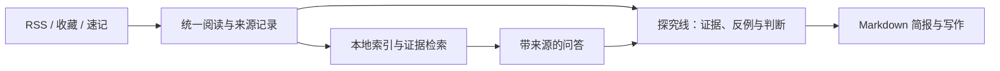
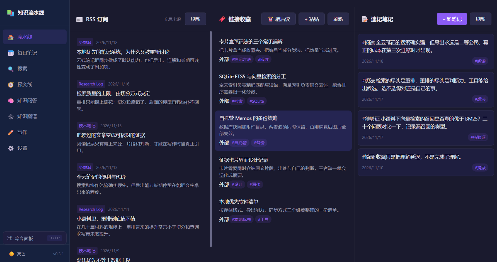
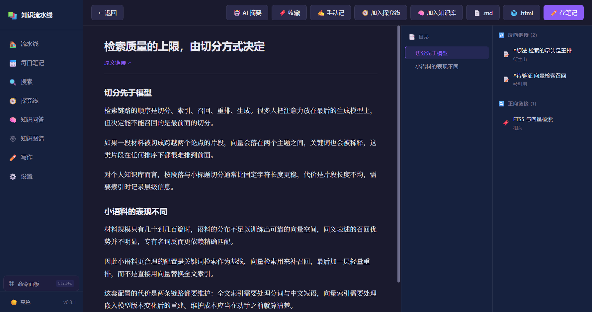
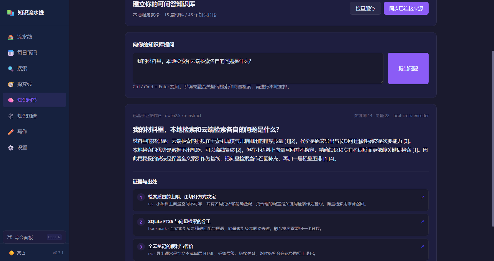
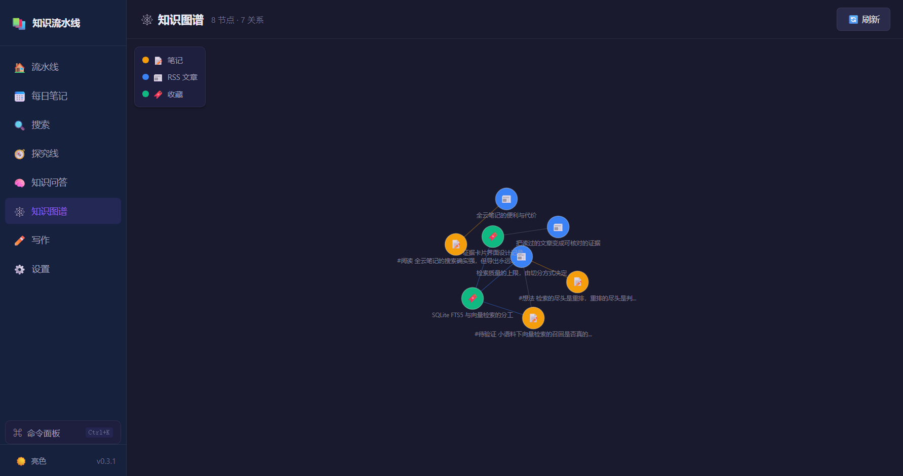
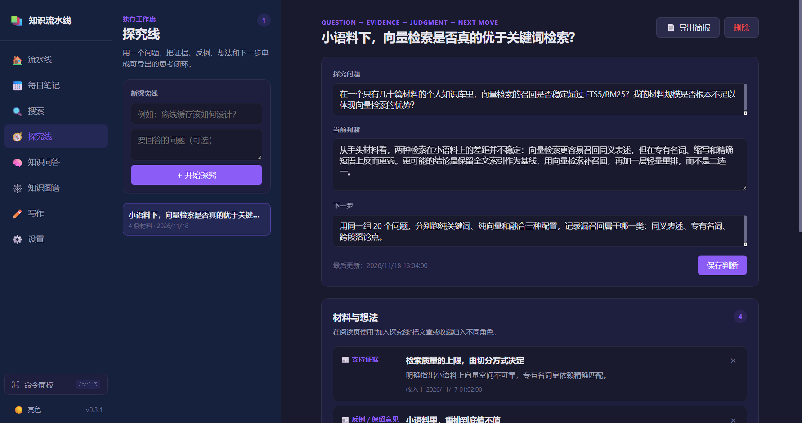
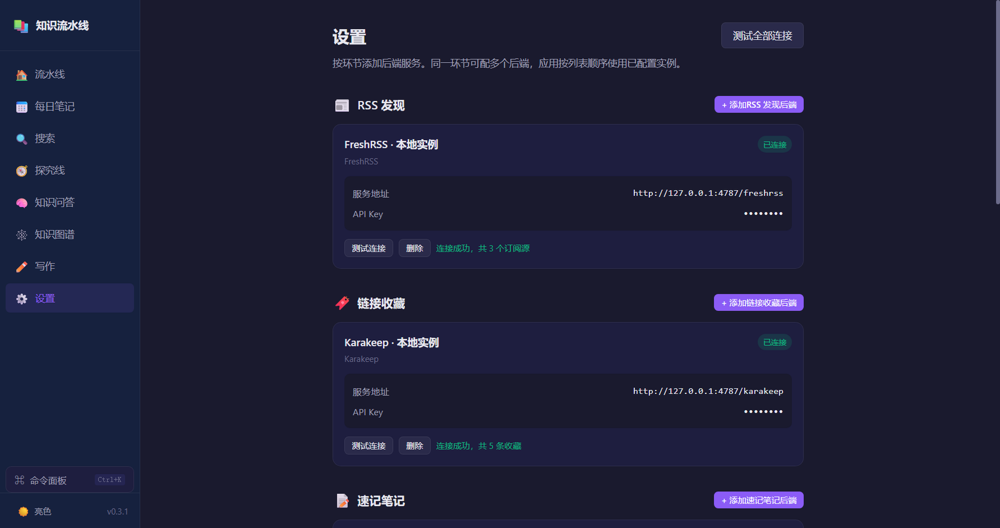

<p align="center">
  
</p>

# 知识流水线 · Knowledge Pipeline

把分散在 **RSS、链接收藏和速记** 中的材料放到一个桌面工作台里：读文章、保存证据、写笔记，再带着来源回答问题，最后整理成自己的判断。

*A desktop workspace for reading, evidence-backed questions and writing.*

**[下载 Windows v0.3.1](https://github.com/tomaxiwu-bit/knowledge-pipeline/releases/tag/v0.3.1)** · [安装与服务配置](docs/SETUP.md) · [AI API 接入](docs/AI_API_SETUP.md) · [架构与接口](docs/DEVELOPMENT.md)

[](https://github.com/tomaxiwu-bit/knowledge-pipeline/actions/workflows/ci.yml)
[](https://github.com/tomaxiwu-bit/knowledge-pipeline/releases)
[](package.json)
[](LICENSE)
[](https://github.com/tomaxiwu-bit/knowledge-pipeline/releases)

## 适合怎样的工作

你已经用 FreshRSS 读订阅、Karakeep 存链接、Memos 记想法，希望把一篇材料从“看过”继续推进到“能引用、能检索、能写进自己的结论”。知识流水线连接这些已有后端，并保存材料之间的关系。



| 从什么开始 | 可以完成什么 | 得到什么 |
|---|---|---|
| 一篇 RSS 或收藏文章 | 阅读、标记、存笔记、加入知识库 | 原文入口与关联笔记 |
| 一个需要材料回答的问题 | 同步材料，检索并查看回答的证据卡 | 可回到原文核对的来源与片段 |
| 一个持续研究的问题 | 将材料标为支持、反例或背景，写下当前判断与下一步 | 可导出的 Markdown 思考简报 |

首次启动需要连接自己的来源服务；未连接时首页会显示配置进度。连接并同步材料后，可按 [演示操作指南](docs/DEMO_SCRIPT.md) 走通阅读、检索、问答和探究线。

## 界面

以下截图由 `npm run screenshots` 生成。脚本用临时配置目录启动桌面端，连接本机 `127.0.0.1:4787` 上的虚构演示后端（FreshRSS、Karakeep、Memos、本机 RAG 与兼容 Chat Completions 的模型），图中的文章、收藏、笔记和问答内容全部是编造的演示数据，不包含任何真实用户资料；想改内容改 `scripts/screenshots/fixtures.cjs` 后重跑即可。

<p align="center"></p>

RSS、链接收藏与速记并排在一个工作台里，读、存、记三个动作不用切换应用。

<p align="center"></p>

阅读视图保留原文结构，右侧同时给出目录与反向链接：哪些笔记由这篇文章衍生、哪些收藏和它相关。

<p align="center"></p>

问答结果附带证据卡与出处，可以点回原文核对，而不是只给一段无法追溯的回答。

| 知识图谱 | 探究线 | 设置与连接检查 |
|:---:|:---:|:---:|
|  |  |  |
| 条目之间按引用、衍生、相关连成图 | 问题、证据、当前判断与下一步放在一起 | 每类后端可配多个实例并逐个检查连接 |

## 先运行桌面端

直接试用可下载 [v0.3.1 Windows 安装包](https://github.com/tomaxiwu-bit/knowledge-pipeline/releases/tag/v0.3.1)。源码运行需要 **Node.js ≥20.19 和 npm**：

```powershell
git clone https://github.com/tomaxiwu-bit/knowledge-pipeline.git
Set-Location knowledge-pipeline
npm ci
npm run electron:dev
```

也可以运行 `npm run dev` 进入开发模式，或用 `npm run electron:build` 构建 Windows 安装包。打开应用后，进入“设置”，添加至少一个 RSS、收藏或速记后端，并测试连接。具体服务地址、凭据与多实例配置见 [安装指南](docs/SETUP.md)。

## 知识问答怎么接入

桌面端负责工作流，本机 FastAPI 服务负责索引和检索。SQLite FTS5 保存全文索引，Chroma 保存向量；检索融合关键词与向量结果，并支持重排。

| 使用方式 | 需要什么 | 数据发送范围 |
|---|---|---|
| 本地 Ollama | 本机知识服务与嵌入 / 对话模型 | 索引与模型推理留在本地部署环境 |
| 云端 AI API | 本机知识服务及所选服务商的 API Key | 摘要原文、问题和检索片段会发送到所选服务商；索引保留本机 |
| 模型暂不可用 | 仍可运行的本机索引服务 | 按可用组件返回检索证据，不伪装成已生成答案 |

完整配置见 [本地服务安装](docs/SETUP.md) 和 [OpenAI / Codex、Claude、DeepSeek 接入](docs/AI_API_SETUP.md)。API 接入使用服务商密钥，不复用聊天客户端的登录状态。

## 其他日常功能

- **阅读与写作**：文章大纲、Markdown 预览、数学公式、Mermaid、模板与 HTML / Markdown 导出。
- **整理与查找**：全局搜索、层级标签、智能集合、反向链接与知识图谱。
- **连续工作**：命令面板、每日笔记、亮暗主题，以及成功读取内容的 7 天只读缓存回退。
- **迁移**：导出关系、模板、探究线和服务元数据；备份剔除密钥，RAG 索引需要单独备份。

离线缓存不等于完整的本地资料归档。RSS、收藏和笔记的原始内容仍依赖连接的后端；不同服务的可用性和备份方式应分别确认。

## 项目结构与验证

```text
src/main/       Electron 主进程、凭据存储与受限 IPC
src/            Vue 3 桌面界面、阅读与写作工作流
server/         FastAPI、SQLite FTS5、Chroma 与检索评测
tests/          桌面端与客户端契约检查
docs/           安装、AI 配置、架构和版本记录
```

在项目根目录运行 `npm run verify`，执行类型检查、前后端测试与构建；后端需要先按 [安装指南](docs/SETUP.md) 准备 uv 环境。独立检索评测入口为 `npm run benchmark:retrieval`，它需要已运行的本机知识服务。

仓库提供的小型评测集用于检查检索链路，不能据此推断真实语料中的回答质量。评测方式、配置与 API 字段见 [开发参考](docs/DEVELOPMENT.md)。

## 文档与反馈

[安装与常见问题](docs/SETUP.md) · [AI API 配置](docs/AI_API_SETUP.md) · [架构与接口](docs/DEVELOPMENT.md) · [发布检查](RELEASE_CHECKLIST.md) · [版本记录](docs/RELEASE_NOTES_v0.3.1.md)

遇到问题请提交 [Issue](https://github.com/tomaxiwu-bit/knowledge-pipeline/issues)，说明版本、连接的后端类型和可复现步骤。设计取舍见 [PRODUCT_REFINEMENT_NOTES.md](PRODUCT_REFINEMENT_NOTES.md)。代码采用 [MIT](LICENSE)。
